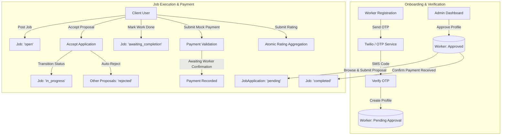

# ServiceHub 🛠️

> **On-Demand Skilled Labor & Client Marketplace for Hubli & Dharwad**

[](https://www.typescriptlang.org/)
[](https://reactjs.org/)
[](https://vitejs.dev/)
[](https://nodejs.org/)
[](https://expressjs.com/)
[](https://www.mongodb.com/)
[](https://tailwindcss.com/)
[](https://jestjs.io/)
[](https://www.selenium.dev/)

---

## 📖 Overview

**ServiceHub** is a dual-sided labor-client web platform built to connect skilled local service professionals (electricians, plumbers, carpenters, painters, cleaners, construction workers) with residential and commercial clients across the twin cities of **Hubli** and **Dharwad**.

The platform streamlines discovery, identity verification, job bidding, transparent job lifecycle transitions, mock escrow payments, and ratings.

---

## ✨ Key Features

- **Role-Based Access Control (RBAC)**: Distinct user journeys tailored for **Clients**, **Labour** (service providers), and **Administrators**.
- **Twilio SMS OTP Verification**: Phone verification with Indian E.164 phone normalization, auto-expiring MongoDB TTL indexes, and mock fallbacks for local testing.
- **Admin Moderation Gate**: Worker profiles require admin verification and approval before workers can browse or apply for jobs.
- **Proposal-Based Job Bidding**: Clients post job requirements with category and duration estimates; approved workers submit proposals.
- **Automated Conflict Resolution**: Accepting one worker proposal automatically marks competing applications as rejected.
- **Escrow-Style Job Lifecycle**:
  - `open` ➔ `in_progress` ➔ `awaiting_completion` ➔ `completed` (or `cancelled`)
  - Work completion confirmation followed by calculated payment validation (`hourlyRate * estimatedHours`).
  - Worker confirms payment receipt to officially close the contract.
- **Transactional Rating Aggregation**: Atomic calculation of worker rating averages upon job completion.
- **Modern Responsive UI**: Built with React, Vite, and Tailwind CSS featuring a glassmorphic design and real-time toast alerts.
- **Automated Testing Suite**: Full coverage with Jest unit/integration tests and end-to-end Selenium browser tests.

---

## 🏛️ System Architecture & Workflow

### Core Job Lifecycle & Escrow Flow



---

## 📂 Repository Structure

```
SE-WT Project/
├── backend/                  # Node.js + Express + TypeScript API server
│   ├── src/
│   │   ├── config/           # Database connection configuration
│   │   ├── controllers/      # Route controllers (Auth, Jobs, Labour, etc.)
│   │   ├── middleware/       # JWT Auth, RBAC, input validation
│   │   ├── models/           # Mongoose schemas (User, Labour, Job, etc.)
│   │   ├── routes/           # Express REST endpoints
│   │   ├── scripts/          # Database seed & migration scripts
│   │   ├── services/         # Twilio SMS & OTP business logic
│   │   ├── tests/            # Jest + Supertest integration test suite
│   │   ├── types/            # TypeScript interfaces & types
│   │   ├── utils/            # JWT helpers, phone formatting utilities
│   │   └── server.ts         # Server entry point
│   ├── package.json
│   └── tsconfig.json
├── frontend/                 # React 18 + Vite + Tailwind CSS SPA
│   ├── src/
│   │   ├── components/       # Reusable UI widgets, Navbar, Modals
│   │   ├── contexts/         # Authentication & Session React Context
│   │   ├── pages/            # Views: Admin, Client, Labour, Public
│   │   ├── utils/            # Axios API client with interceptors
│   │   ├── App.tsx           # Router configuration & route guards
│   │   ├── main.tsx          # Application entry point
│   │   └── index.css         # Tailwind directives & glassmorphic styling
│   ├── tailwind.config.js    # Design system configuration
│   └── vite.config.ts        # Vite configuration
└── selenium_tests/           # End-to-end Python browser automation
    ├── tests/                # Test scenarios (Login, Job Service Flow)
    └── utils/                # WebDriver configurations
```

---

## 🛠️ Tech Stack

| Domain | Technology | Description |
|---|---|---|
| **Frontend** | React 18, Vite | High-performance single page application |
| | TypeScript | Type-safe component development |
| | Tailwind CSS | Utility-first styling with custom glassmorphism |
| | React Query | Server state synchronization & cache management |
| | React Hook Form | Performant client-side form validation |
| | Lucide React | Modern icon suite |
| **Backend** | Node.js & Express | RESTful API service |
| | TypeScript | Strict compile-time typing |
| | MongoDB & Mongoose | Document database with schema modeling |
| | JWT & bcryptjs | Stateless auth & salted password hashing |
| | Helmet & Rate Limit | HTTP security headers & brute-force protection |
| | Twilio SDK | SMS OTP delivery (with local mock mode) |
| **Testing** | Jest & Supertest | Backend route testing & DB assertions |
| | MongoDB Memory Server | Isolated in-memory database for testing |
| | Selenium WebDriver | Cross-browser automated user journeys |

---

## 🚀 Getting Started

### Prerequisites

Ensure the following are installed on your machine:
- [Node.js](https://nodejs.org/) (v18.0.0 or higher recommended)
- [npm](https://www.npmjs.com/) (v9.0.0 or higher)
- [MongoDB](https://www.mongodb.com/try/download/community) (running locally on port `27017` or a MongoDB Atlas URI)
- [Python 3.8+](https://www.python.org/) *(Optional, required only for Python Selenium tests)*
- [Google Chrome](https://www.google.com/chrome/) *(For Selenium automation)*

---

### 1. Clone the Repository

```bash
git clone https://github.com/pruthvi-24/servicehub.git
cd "SE-WT Project"
```

---

### 2. Backend Setup

1. **Navigate to the backend directory**:
   ```bash
   cd backend
   ```

2. **Install dependencies**:
   ```bash
   npm install
   ```

3. **Configure environment variables**:
   Create a `.env` file in the `backend/` directory based on `.env.example`:
   ```bash
   cp .env.example .env
   ```

   Default configuration:
   ```env
   NODE_ENV=development
   PORT=8080
   MONGODB_URI=mongodb://localhost:27017/labour_portal
   JWT_SECRET=your-super-secret-jwt-key-change-in-production
   SMS_MOCK=true
   EMAIL_MOCK=true
   FRONTEND_URL=http://localhost:3000
   ```

   > [!NOTE]
   > When `SMS_MOCK=true`, OTP verification uses the test bypass code `1234` or accepts any test verification on number `+919980159919`.

4. **Seed the database with initial demo data**:
   ```bash
   npm run seed
   ```

5. **Start the backend development server**:
   ```bash
   npm run dev
   ```
   The backend API will be accessible at: `http://localhost:8080` (Health check: `http://localhost:8080/health`).

---

### 3. Frontend Setup

1. **Open a new terminal and navigate to `frontend/`**:
   ```bash
   cd frontend
   ```

2. **Install dependencies**:
   ```bash
   npm install
   ```

3. **Start the frontend development server**:
   ```bash
   npm run dev
   ```
   The application will be running at: `http://localhost:3000`.

---

## 👥 Demo & Test Credentials

After running `npm run seed` in the backend, the following pre-configured accounts are available:

| Role | Email / Phone | Password | Status / Permissions |
|---|---|---|---|
| **Admin** | `admin@portal.com` | `admin123` | Full administrative & worker approval rights |
| **Client** | `client@example.com` (`+919876543210`) | `client123` | Post jobs, accept applications, make payments |
| **Client** | `john@company.com` (`+919876543211`) | `john123` | Post jobs, review proposals |
| **Labour** | `+919876543220` | `labour123` | **Approved** (Plumbing, Electrical) - Hubli |
| **Labour** | `+919876543221` | `labour123` | **Approved** (Carpentry) - Dharwad |
| **Labour** | `+919876543222` | `labour123` | **Pending Approval** (Painting, Cleaning) - Hubli |
| **Labour** | `+919876543223` | `labour123` | **Approved** (Gardening, Construction) - Dharwad |

---

## 📡 REST API Reference

### Authentication & Profile (`/api/auth`)
- `POST /api/auth/register/client` - Register a new client profile
- `POST /api/auth/register/labour` - Register a new worker profile (with OTP verification)
- `POST /api/auth/login` - Authenticate user & receive JWT token
- `POST /api/auth/otp/send` - Generate & dispatch 4-digit SMS OTP
- `POST /api/auth/otp/verify` - Verify phone OTP

### Jobs (`/api/jobs`)
- `POST /api/jobs` - Create a new job listing *(Client only)*
- `GET /api/jobs/available` - List open jobs in worker's city/category *(Approved Labour only)*
- `GET /api/jobs/my-jobs` - Retrieve user-specific jobs
- `GET /api/jobs/:id` - Fetch detailed job information
- `PATCH /api/jobs/:id/status` - Transition job execution state
- `POST /api/jobs/:id/complete` - Mark job completed and submit rating

### Job Applications (`/api/jobs`)
- `POST /api/jobs/:jobId/apply` - Submit proposal for a job *(Labour only)*
- `GET /api/jobs/:jobId/applications` - View applications for a job *(Job owner only)*
- `PATCH /api/jobs/applications/:id/accept` - Accept proposal, reject others, move job to `in_progress`
- `PATCH /api/jobs/applications/:id/reject` - Reject specific proposal

### Labour & Administration (`/api/labour`)
- `GET /api/labour/pending` - List unapproved worker profiles *(Admin only)*
- `PATCH /api/labour/:id/approve` - Approve or reject worker profile *(Admin only)*
- `GET /api/labour/:id/status` - Check current worker approval status

### Payments & Ratings
- `POST /api/payments/mock-payment` - Process mock transaction against job budget
- `POST /api/ratings` - Record client review and calculate updated worker average

---

## 🧪 Running Tests

### Backend Unit & Integration Tests (Jest)

The backend test suite uses `mongodb-memory-server` for database isolation:

```bash
cd backend
npm test
```

To run in watch mode:
```bash
npm run test:watch
```

### End-to-End Automated Tests (Selenium)

Ensure both backend (`localhost:8080`) and frontend (`localhost:3000`) servers are actively running.

#### Option A: Node.js Selenium Runner
```bash
cd frontend
node run_all_tests.js
```

#### Option B: Python Selenium Suite
```bash
cd selenium_tests/tests
python run_all_tests.py
```

---

## 🛡️ Security Implementation

- **Strict Param Validation**: All payloads validated using `express-validator` prior to controller invocation.
- **Header Hardening**: `helmet` enabled to enforce standard HTTP security practices (CSP, X-Frame-Options).
- **Rate Limiting**: IP-based rate limiting via `express-rate-limit` (100 requests per 15-minute window).
- **Password Hashing**: 12-round `bcryptjs` salt hashing implemented via Mongoose schema pre-save hooks.
- **Database Safety**: MongoDB TTL index on OTP tokens prevents stale credential persistence.

---

## 📄 License

This project is licensed under the ISC License.
